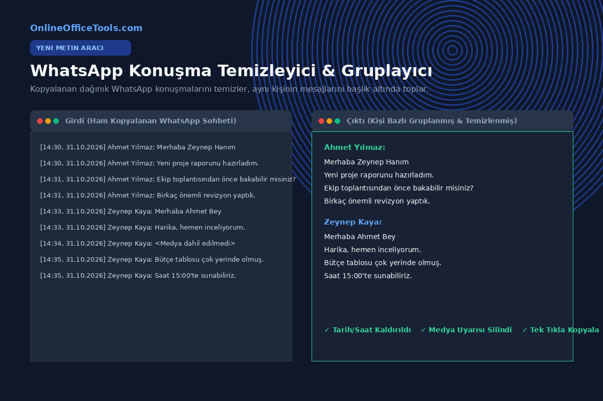
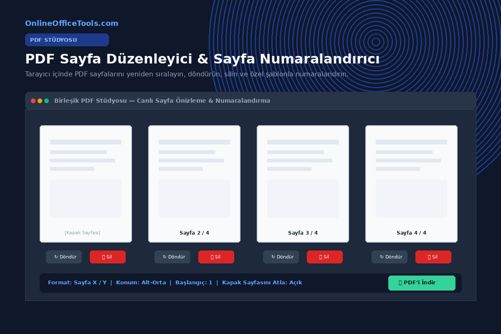
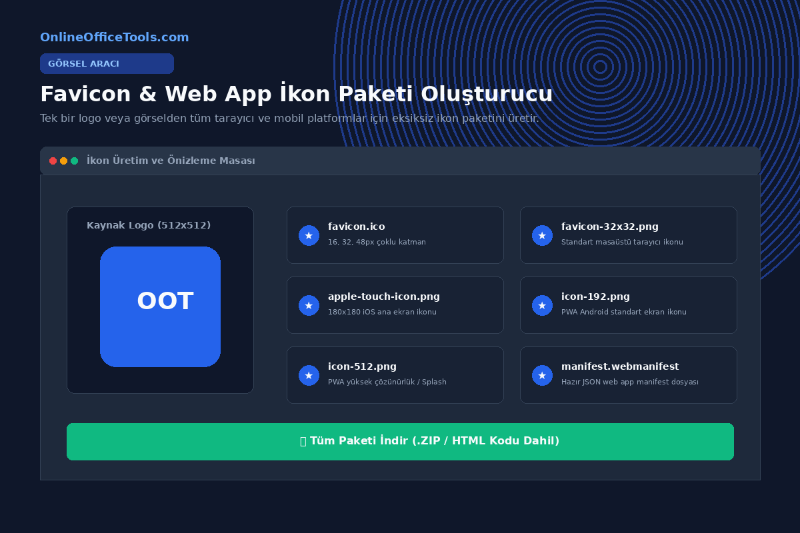
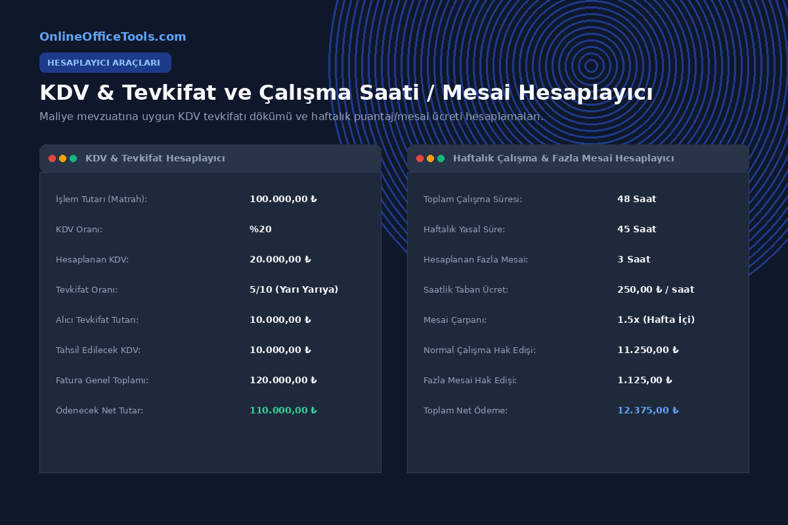
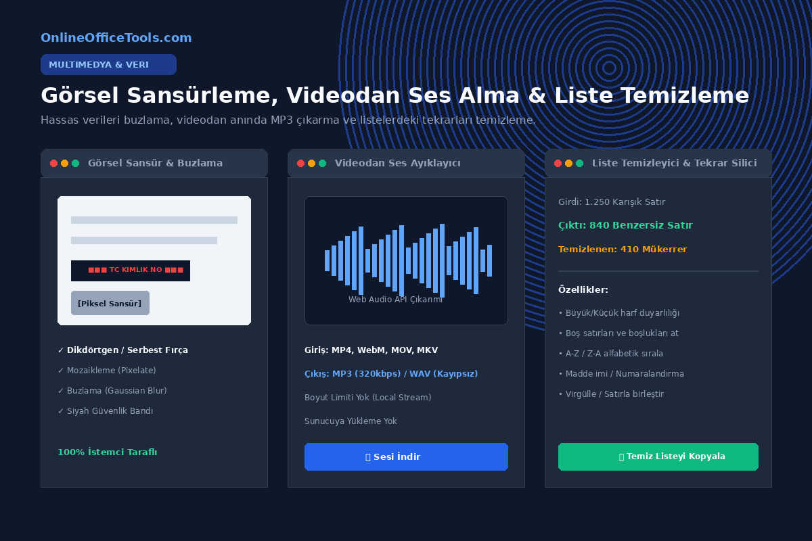

# Online Office Tools — Son Eklenen Araçlar ve Özellikler Rehberi

Online Office Tools (`onlineofficetools.com`), belgelerinizi veya dosyalarınızı hiçbir uzak sunucuya yüklemeden, **%100 tarayıcı içinde (WebAssembly ve modern Web API'leri ile)** güvenle işlemenizi sağlayan yeni nesil bir ofis platformudur.

Sitemizde toplam **69 bağımsız ve optimize araç** yer almaktadır. Bu dökümanda, yakın zamanda platforma kazandırılan 9 yeni araç ve gelişmiş kullanım senaryoları detaylandırılmıştır.

---

## 1. WhatsApp Konuşma Temizleyici & Gruplayıcı (`/tools/whatsapp-cleaner`)
WhatsApp Web, Masaüstü uygulaması veya mobil iOS/Android cihazlardan kopyalanan konuşmalardaki gereksiz tarih, saat damgalarını, görünmez Unicode karakterlerini ve sistem bildirimlerini temizler.

### Temel Yetenekler
- **Kişi Bazlı Otomatik Gruplama:** Aynı kişinin ardışık tüm mesajlarını tek bir isim başlığı altında toplar (`İsim: Mesaj 1 \n Mesaj 2`).
- **Sistem Gürültüsü Filtresi:** 8 farklı dilde `<Medya dahil edilmedi>`, `Bu mesaj silindi`, `Uçtan uca şifrelidir` gibi yer tutucuları ve tek başına duran saat satırlarını otomatik siler.
- **Konuşmacı Yönetimi:** Katılımcıların isimlerini düzenleme (ör. telefon numaralarını gerçek isimlerle değiştirme) ve istenmeyen kişilerin mesajlarını gizleme.
- **Kullanım Alanları:** Müşteri destek kayıtlarını derleme, hukuki/resmi metin haline getirme, toplantı notları çıkarma ve arşivleme.

---

## 2. Birleşik PDF Stüdyosu: Sayfa Numaralandırıcı & Düzenleyici
PDF belgelerini parçalamadan tek bir stüdyo arayüzünde canlı önizlemeyle organize etmenizi sağlar.

### Araçlar:
1. **PDF Sayfa Numaralandırıcı (`/tools/pdf-page-numberer`):**
   - Sayfa numarası ekleme (`Sayfa X / Y`, `X / Y`, `Sayfa X`).
   - Konumlandırma: Alt-Orta, Alt-Sağ, Alt-Sol, Üst-Orta vb.
   - Kapak sayfasını atlama (Skip Cover Page) ve özel başlangıç numarası tanımlama.
2. **PDF Sayfa Düzenleyici (`/tools/pdf-organize`):**
   - Sayfaları görsel kartlar üzerinde sürükleyip bırakarak yeniden sıralama.
   - Hatalı taranmış sayfaları tek tek 90° döndürme veya istenmeyen sayfaları silme.

---

## 3. Favicon & Web App İkon Paketi Oluşturucu (`/tools/favicon-generator`)
Web siteleri, kurumsal portallar ve Progressive Web App (PWA) projeleri için tek bir görselden eksiksiz favicon seti oluşturur.

### Çıktı Paket İçeriği (.ZIP):
- `favicon.ico`: 16x16, 32x32 ve 48x48 pencerelerini barındıran çok katmanlı Windows/Tarayıcı ikonu.
- `apple-touch-icon.png`: iOS cihazlar için 180x180 retina ikon.
- `icon-192.png` & `icon-512.png`: Android ve PWA manifest ekran ikonları.
- `manifest.webmanifest`: Doğrudan projeye kopyalanmaya hazır web app manifest JSON dosyası.
- HTML `<head>` etiketleri tek tıkla kopyalanabilir.

---

## 4. KDV & Tevkifat ve Çalışma Saati / Fazla Mesai Hesaplayıcı
Maliye mevzuatına uygun fatura tevkifatı hesaplamaları ve işletmeler için haftalık mesai puantajı.

### Araçlar:
1. **KDV & Tevkifat Hesaplayıcı (`/tools/vat-calculator`):**
   - KDV dahil veya hariç tutardan matrah tespiti.
   - Yasal tevkifat dilimleri (2/10, 3/10, 4/10, 5/10, 7/10, 9/10).
   - Alıcı tarafından tevkif edilecek KDV, satıcının tahsil edeceği KDV ve ödenecek net fatura tutarı dökümü.
2. **Çalışma Saati & Fazla Mesai Hesaplayıcı (`/tools/work-hours-calculator`):**
   - Günlük giriş-çıkış ve mola süreleri ile net çalışma saatleri.
   - 45 saati aşan sürelerin 1.5x katsayı ile hesaplanıp toplam hak edişe dönüştürülmesi.

---

## 5. Görsel Sansürleme, Videodan Ses Ayıklayıcı & Liste Temizleme

1. **Görsel Sansürleme & Buzlama (`/tools/image-blur`):**
   - Belgelerdeki T.C. kimlik no, imza, kredi kartı veya fotoğraflardaki yüz/plaka bilgilerini mozaikleme (pixelate), buzlama (Gaussian blur) veya siyah güvenlik bandıyla kapatır.
2. **Videodan Ses Ayıklayıcı (`/tools/video-to-audio`):**
   - MP4, WebM, MOV video dosyalarını yükleme sınırı olmadan tarayıcı belleğinde işler ve sesi doğrudan 320kbps MP3 ya da kayıpsız WAV olarak kaydeder.
3. **Liste Temizleyici & Mükerrer Silici (`/tools/list-cleaner`):**
   - Binlerce satırlık listelerdeki mükerrer kayıtları ayıklar, boşlukları temizler, A-Z sıralar ve numaralandırarak dışa aktarır.

---

## Neden Online Office Tools?
- 🔒 **%100 Gizlilik:** Belgeleriniz ve verileriniz asla sunucularımıza gitmez; tüm hesaplamalar cihazınızın işlemcisinde gerçekleşir.
- ⚡ **Sıfır Bekleme & Limitsiz:** Dosya boyutu kuyrukları veya üyelik zorunluluğu yoktur.
- 🌍 **8 Dil Desteği:** Türkçe, İngilizce, Almanca, Fransızca, İspanyolca, İtalyanca, Portekizce ve Rusça dillerinde eksiksiz deneyim.
